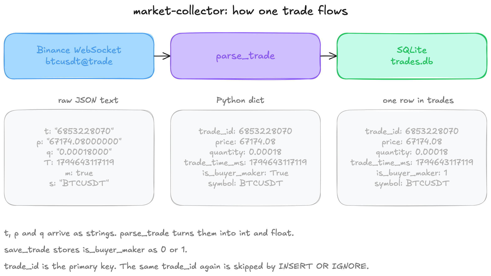
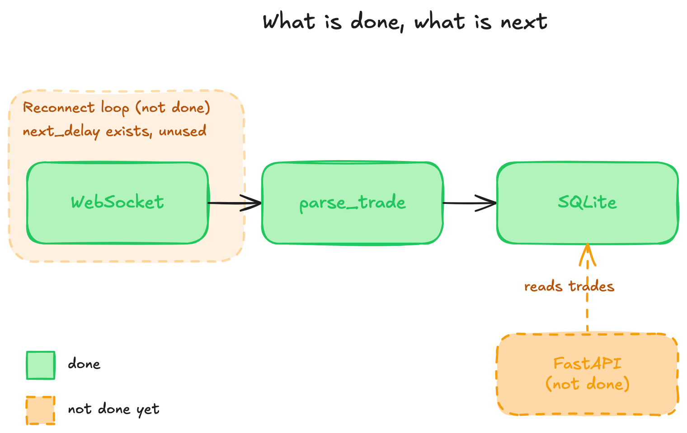

# market-data-collector

market-data-collector connects to Binance's public WebSocket stream and listens to live BTC/USDT trades. It parses each trade message and saves it to a local SQLite database, skipping any trade it has already stored.

## How to run

```bash
python3 -m venv .venv
source .venv/bin/activate
pip install -r requirements.txt
python project.py
```

The script prints one sample parsed trade, collects 5 live trades into `trades.db`, prints the row count and exits.

## How to test

```bash
pytest
```

## How it works

```
WebSocket → parse_trade → SQLite
```



- `main()` opens `wss://data-stream.binance.vision/ws/btcusdt@trade` with `websockets` and reads trade messages as they arrive.
- `parse_trade` turns each raw JSON message into a dict with `trade_id`, `price`, `quantity`, `trade_time_ms`, `is_buyer_maker` and `symbol`.
- `init_db` creates a `trades` table in `trades.db` with those same six columns, and `save_trade` inserts each trade into it. `trade_id` is the primary key and the insert uses `INSERT OR IGNORE`, so a repeated trade is skipped.

## Status



Done:

- Connects to the Binance BTC/USDT trade stream and reads live messages.
- `parse_trade`, `init_db` and `save_trade` work and each has a test. Saving the same trade twice leaves one row.
- `next_delay(attempt)` returns the wait before a reconnect: 1, 2, 4 seconds and so on, doubling each attempt up to 60 seconds. It has a test.

Not done yet:

- Reconnect loop. `next_delay` exists but nothing calls it, so the script ends if the connection drops.
- FastAPI. There is no API on top of the stored trades.

Other limit: the script stops after 5 trades.
